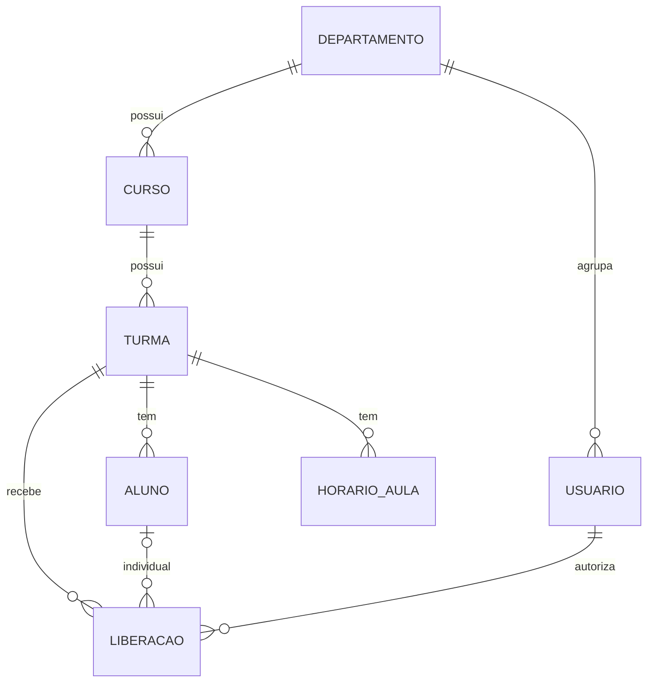

# Guia do Grupo 5 – Portal Saída

## 0. Como dividir o trabalho (Barema)
| Integrante | Entrega principal | Onde mexer |
|---|---|---|
| **Eliseu** (Lead/Back) | Repositório, branches, revisão de PRs, regras de negócio, diagrama de classes | `service/`, `controller/`, `security/` |
| **João** (Back/BD) | DER, modelo relacional, DDL, entidades/repositórios, carga de dados reais, MySQL | `model/`, `repository/`, `DataLoader`, `application*.properties` |
| **Artur** (Front) | Telas Thymeleaf, validações visíveis, CSS, usabilidade | `templates/`, `static/css` |
| **Yasmin** (Docs) | Requisitos, entrevistas, casos de uso, preenchimento da Barema | `docs/` + Barema |
| **Maria Clara** (Testes) | Plano de testes, JUnit, testes manuais, Issues de bugs | `src/test/`, plano de testes |

## 1. Fluxo Git (Barema 3.7)
1. Eliseu cria o repo, sobe este projeto na `main` e cria `develop`. Adiciona todos como colaboradores.
2. Cada tarefa = uma branch `feature/<nome>` saindo de `develop`; commits no padrão `feat:`, `fix:`, `docs:`, `test:`.
3. Pull Request para `develop`, revisado por outra pessoa. Nada direto na `main`.
4. Ao fim de cada checkpoint: PR `develop` → `main` com tag (`v0.1`, `v0.2`...).

## 2. Requisitos
**Funcionais**
- RF01 Manter departamentos, cursos, turmas, alunos e usuários.
- RF02 Manter horários de aula por turma e dia da semana (sem conflitos).
- RF03 Autorizar saída de turma inteira com motivo, justificativa e comprovação.
- RF04 Autorizar saída individual de aluno com motivo, justificativa e comprovação.
- RF05 Consultar e filtrar liberações por data; cancelar liberação.
- RF06 Painel com as saídas autorizadas do dia (uso da portaria).
- RF07 Imprimir a autorização.
- RF08 Cada departamento enxerga e opera apenas sobre os seus cursos/turmas.

**Não funcionais**
- RNF01 Acesso apenas com login; permissões por perfil.
- RNF02 Registrar quem autorizou e quando.
- RNF03 Senhas armazenadas com hash.
- RNF04 Interface responsiva (celular e desktop).
- RNF05 Arquitetura MVC em camadas (Controller → Service → Repository).

## 3. Casos de uso (atores: Secretário, Coordenador, Administrador, Portaria*)
UC01 Autenticar · UC02 Autorizar saída de turma · UC03 Autorizar saída de aluno · UC04 Cancelar liberação ·
UC05 Consultar liberações · UC06 Gerenciar horários · UC07 Gerenciar turmas/alunos/cursos · UC08 Gerenciar departamentos e usuários.
*Portaria hoje usa um login de secretário só para consultar; um perfil próprio é evolução (seção 6).

**Modelo de especificação textual (Yasmin repete para cada UC) – exemplo UC02**
- **Ator:** Secretário. **Pré-condição:** logado; turma cadastrada com horários.
- **Fluxo principal:** 1) escolhe "Nova liberação" 2) tipo = Turma inteira 3) seleciona turma, data/hora, motivo, justificativa e comprovação 4) sistema valida 5) registra como AUTORIZADA e abre a tela de impressão.
- **Fluxos alternativos:** A1) horário fora das aulas → erro e retorno ao formulário. A2) turma já liberada no dia → erro. A3) turma de outro departamento → erro.
- **Pós-condição:** liberação registrada com autor e data/hora.

## 5. DER (Mermaid – cole em https://mermaid.live ou no GitHub)

Para o DDL, copie o SQL que aparece no console ao iniciar (`show-sql=true`) ou do H2 Console (`SCRIPT`).

## 6. Evoluções sugeridas (para os integrantes implementarem)
1. Perfil **PORTARIA** (somente leitura do painel do dia).
2. Importar horários de um CSV.
3. Notificar responsáveis (e-mail) ao autorizar saída de aluno.
4. Relatório por período/motivo (contagem com `@Query` no `LiberacaoRepository`).
5. Spring Security + BCrypt no lugar do `AuthInterceptor`/`SenhaUtil`.
6. Paginação das listagens.

## 7. Testes (Maria Clara)
- Automatizados: `LiberacaoServiceTest` (já inclui 7 casos). Crie `TurmaServiceTest`, `HorarioServiceTest` (conflito de horário) e `UsuarioServiceTest`.
- Manuais (um roteiro por UC): logar com cada perfil e tentar acessar `/usuarios` (deve negar), `/liberacoes/nova` como coordenador (deve negar), autorizar saída fora do horário (deve recusar), autorizar duas vezes a mesma turma (deve recusar), excluir turma com alunos (deve recusar).

## 8. Mapa para a Barema
3.1/3.4 → seções 3 e 4 · 3.2 → seção 5 + entidades · 3.3 → diagrama de classes + pacotes · 3.5 → `service/`, `controller/`, `model/`, `repository/` · 3.6 → `templates/` · 3.7 → histórico de commits/PRs.
